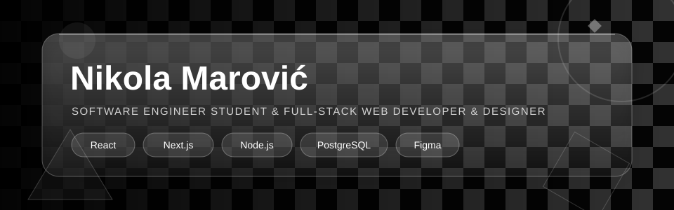

  

  
  
  

## Tech Stack

**Frontend**

**Backend**

**Databases & Cloud**

**Design & Tools**

## Featured Projects

- **[BrainPulse](https://nikolalmn.com/projects/brainpulse)**: AI-powered SaaS for text, image, video, sound, and code generation
- **[Shoppy CMS](https://nikolalmn.com/projects/shoppy-cms)**: content management system for e-commerce stores, built with Next.js
- **[Sendio](https://nikolalmn.com/projects/sendio)**: real-time full-stack chat app
- **[EduLearn](https://nikolalmn.com/projects/edulearn)**: learning management system for course streaming and publishing
- **[SaaS Project](https://github.com/marovichn/SaaS-Project)**: TypeScript SaaS starter with AI, Clerk, Stripe, and Crisp

  
  
  

Always learning and open to freelance collaboration

